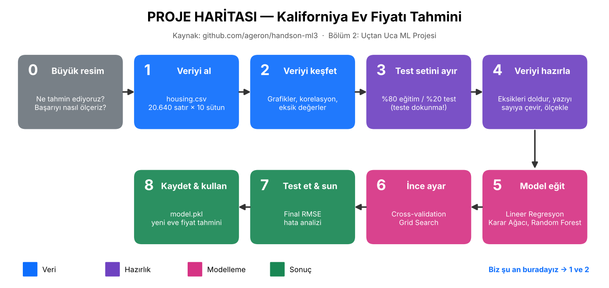
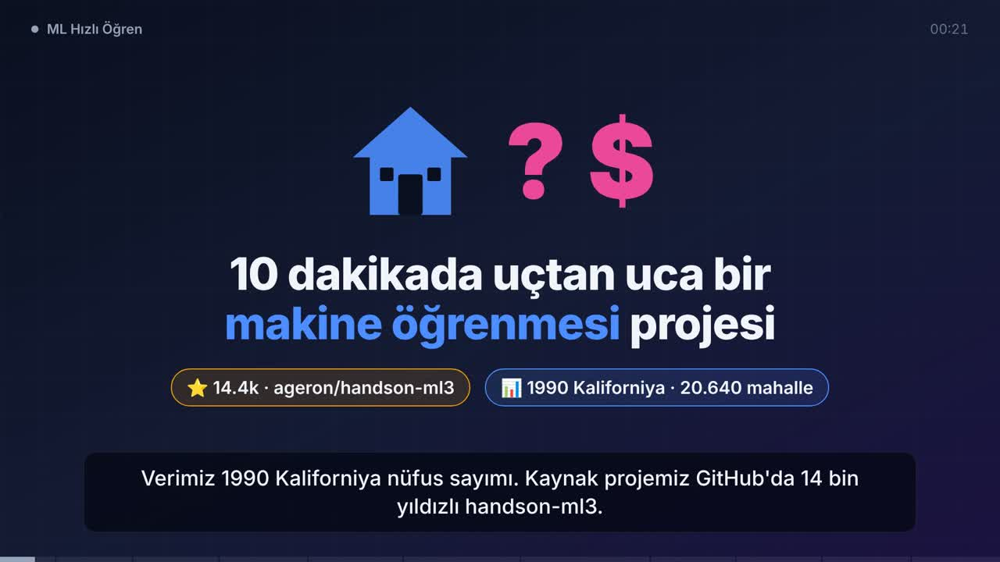

# ML Hızlı Öğren — Kaliforniya Ev Fiyatı Tahmini

Sıfırdan, uygulamalı, adım adım makine öğrenmesi.
Referans proje: [ageron/handson-ml3](https://github.com/ageron/handson-ml3) (14.4k ⭐, Apache-2.0).
Kitaptaki **Bölüm 2: Uçtan Uca ML Projesi**'ni sadeleştirip birlikte yeniden yazıyoruz.



## Neden bu proje?

| Kriter | Durum |
|---|---|
| Veri küçük mü? | ✅ 1 CSV, 1,4 MB, 20.640 satır |
| Kod basit mi? | ✅ pandas + scikit-learn, ~150 satır |
| Hızlı sonuç? | ✅ Eğitim CPU'da saniyeler-dakikalar |
| Kaliteli mi? | ✅ ML eğitiminde en çok kullanılan "ilk gerçek proje" |

## Problem tek cümlede

> Kaliforniya'daki bir **mahallenin** (district) özelliklerine bakarak oradaki
> **medyan ev fiyatını** tahmin et.

- **Girdi (X, özellikler):** konum, ev yaşı, oda sayısı, nüfus, gelir, okyanusa yakınlık…
- **Çıktı (y, hedef):** `median_house_value`
- **Tür:** Denetimli öğrenme (supervised) → **Regresyon** (sayı tahmini)
- **Başarı ölçüsü:** RMSE (ortalama ne kadar dolar yanılıyoruz?)

## Sonuç

| | RMSE |
|---|---|
| Lineer Regresyon (CV) | 67.689 $ |
| Karar Ağacı (CV) | 70.886 $ |
| Random Forest, ince ayarlı (CV) | 49.140 $ |
| **Random Forest, TEST SETİ** | **47.510 $** (%95 GA: 45.4k–49.5k) |

## 🎬 10 dakikalık özet video

Projeyi ML'e yeni başlayanlara anlatan 11 sahnelik eğitim videosu ([Remotion](https://www.remotion.dev/) ile üretildi).

[](video/ml_ozet.mp4)

- **Video:** [video/ml_ozet.mp4](video/ml_ozet.mp4) (9:59, 1080p, 30 MB, altyazılı)
- Zaman kodlu senaryo: [docs/08_video_senaryo.md](docs/08_video_senaryo.md)
- Kaynak kod ve render talimatı: [video/](video/README.md)

## Klasör yapısı

```
ML_hizli_ogren/
├── README.md                 ← bu dosya: harita + ilerleme
├── data/housing/housing.csv  ← ham veri (dokunmuyoruz)
├── data/hazir/               ← egitim.csv (%80) + test.csv (%20)
├── docs/                     ← her aşamanın ders notu
├── src/                      ← birlikte yazdığımız Python kodları
├── modeller/                 ← kaydedilen hazırlayıcı, modeller, sonuclar.json
├── loglar/                   ← eğitim logları (canlı izleme)
├── gorseller/                ← grafikler
└── video/                    ← 10 dk özet videonun Remotion kaynağı
```

## İlerleme

| # | Aşama | Durum | Ders notu | Kod |
|---|---|---|---|---|
| 0 | Büyük resim | ✅ | [docs/01_veri.md](docs/01_veri.md) | — |
| 1 | Veriyi al | ✅ | [docs/01_veri.md](docs/01_veri.md) | — |
| 2 | Veriyi keşfet | ✅ | [docs/01_veri.md](docs/01_veri.md) | [src/00_gorselleri_ciz.py](src/00_gorselleri_ciz.py) |
| 3 | Test setini ayır | ✅ | [docs/02_test_ayir.md](docs/02_test_ayir.md) | [src/01_test_setini_ayir.py](src/01_test_setini_ayir.py) |
| 4 | Veriyi hazırla | ✅ | [docs/03_hazirla.md](docs/03_hazirla.md) | [src/02_veriyi_hazirla.py](src/02_veriyi_hazirla.py), [src/hazirlik.py](src/hazirlik.py) |
| 5 | Model eğit | ✅ | [docs/04_model_egit.md](docs/04_model_egit.md) | [src/03_model_egit.py](src/03_model_egit.py) |
| 6 | İnce ayar | ✅ | [docs/05_ince_ayar.md](docs/05_ince_ayar.md) | [src/04_ince_ayar.py](src/04_ince_ayar.py) |
| 7 | Test et & sun | ✅ | [docs/06_test_et.md](docs/06_test_et.md) | [src/05_test_et.py](src/05_test_et.py) |
| 8 | Kaydet & kullan | ✅ | [docs/07_kullan.md](docs/07_kullan.md) | [src/06_tahmin_et.py](src/06_tahmin_et.py) |

## Projede öğrenilen kavramlar

| Ders | Kavramlar |
|---|---|
| 1 | özellik/hedef, denetimli öğrenme, regresyon, eksik değer, kategorik veri, korelasyon |
| 2 | test seti, data snooping, tabakalı örnekleme, `random_state` |
| 3 | feature engineering, imputation, one-hot encoding, standardizasyon, `fit`/`transform`, veri sızıntısı |
| 4 | RMSE, underfitting/overfitting, cross-validation, Random Forest, OOB, özellik önemi |
| 5 | parametre vs hiperparametre, Pipeline, Grid Search, bias–variance dengesi |
| 6 | final test, MAE, güven aralığı, hata analizi, ortalamaya çekilme |
| 7 | modeli kaydetme/kullanma, ağaçların extrapolation sınırı, veri kayması, izleme |

## Çalıştırma

```bash
pip install pandas scikit-learn matplotlib joblib
python src/00_gorselleri_ciz.py
python src/01_test_setini_ayir.py
python src/02_veriyi_hazirla.py
python src/03_model_egit.py        # canlı izlemek için başka terminalde: tail -f loglar/egitim.log
python -u src/04_ince_ayar.py | tee loglar/ince_ayar.log   # ~2 dk, modeller/en_iyi_model.joblib üretir
python src/05_test_et.py           # final sınav: test RMSE + hata analizi
python src/06_tahmin_et.py --sehir los_angeles --gelir 80000 --yas 20 --grafik   # yeni mahalleye tahmin
```
