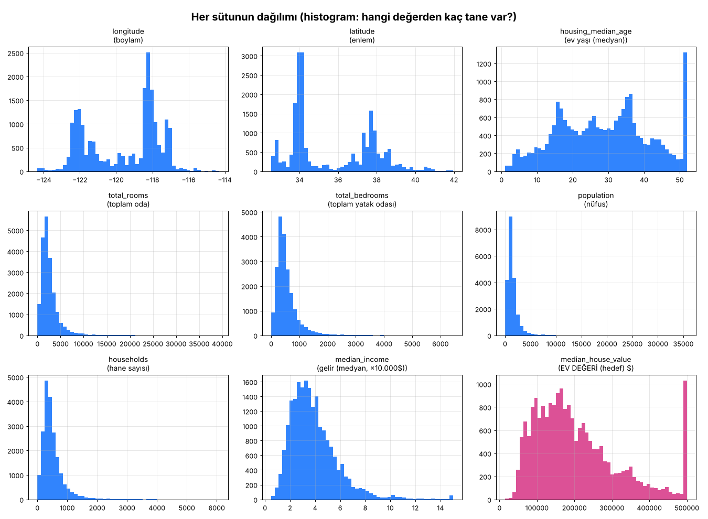
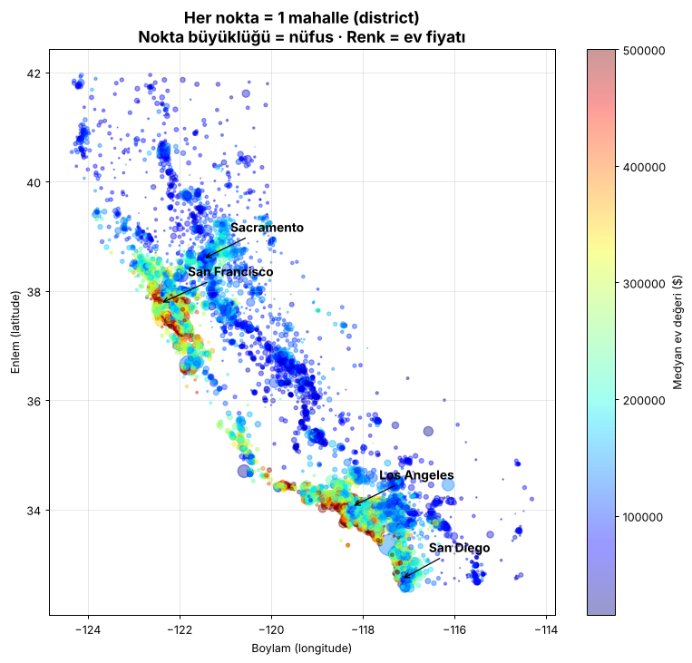
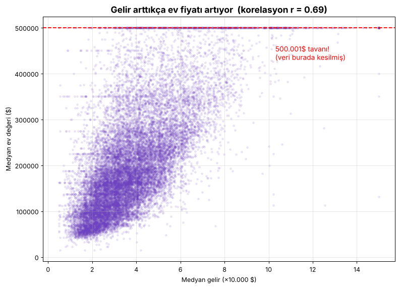

# Ders 1 — Büyük resim ve veriyi tanımak (Aşama 0, 1, 2)

## Aşama 0: Büyük resim

Bir emlak şirketi düşün. Elinde Kaliforniya'nın 1990 nüfus sayımından gelen
mahalle bazlı veriler var. İstediği şey: **"Bu mahallede evler ortalama kaç para eder?"**
sorusunu bir uzmana sormadan, otomatik ve hızlı cevaplamak.

| Soru | Cevap |
|---|---|
| Elimizde doğru cevaplı örnekler var mı? | Evet, her satırda gerçek fiyat var → **denetimli öğrenme** |
| Tahmin ettiğimiz şey sayı mı, sınıf mı? | Sayı (dolar) → **regresyon** |
| Veri akıyor mu, sabit mi? | Sabit bir dosya → **batch (toplu) öğrenme** |
| Başarıyı nasıl ölçeriz? | **RMSE**: tahminlerimiz ortalama kaç $ sapıyor |

## Aşama 1: Veriyi al

Kaynak: `https://github.com/ageron/data/raw/main/housing.tgz` → açınca `housing.csv`.

- **20.640 satır**: her satır 1 mahalle (district, ~600–3000 kişi)
- **10 sütun**: 9 özellik + 1 hedef

### Sütunlar

| Sütun | Türkçe | Tür | Not |
|---|---|---|---|
| `longitude` | boylam | sayı | konum |
| `latitude` | enlem | sayı | konum |
| `housing_median_age` | ev yaşı (medyan) | sayı | 52'de kesilmiş |
| `total_rooms` | toplam oda | sayı | mahallenin toplamı! |
| `total_bedrooms` | toplam yatak odası | sayı | **207 eksik değer** |
| `population` | nüfus | sayı | |
| `households` | hane sayısı | sayı | |
| `median_income` | medyan gelir | sayı | ×10.000 $, 0,5–15 arasında sınırlanmış |
| `ocean_proximity` | okyanusa yakınlık | **yazı (kategori)** | 5 değer |
| `median_house_value` | **medyan ev değeri** | sayı | **HEDEF**, 500.001 $'da kesilmiş |

### İlk 5 satır

```
longitude latitude age  rooms bedrooms pop  households income  value   ocean
 -122.23   37.88   41   880   129      322  126        8.33    452600  NEAR BAY
 -122.22   37.86   21   7099  1106     2401 1138       8.30    358500  NEAR BAY
 -122.24   37.85   52   1467  190      496  177        7.26    352100  NEAR BAY
```

### `ocean_proximity` dağılımı

| Değer | Adet |
|---|---|
| <1H OCEAN (okyanusa <1 saat) | 9.136 |
| INLAND (iç bölge) | 6.551 |
| NEAR OCEAN | 2.658 |
| NEAR BAY (körfeze yakın) | 2.290 |
| ISLAND (ada) | 5 |

## Aşama 2: Veriyi keşfet (görseller)

### Histogramlar


Dikkat çekenler:
1. `median_house_value` ve `housing_median_age` grafiklerinin sağında **ani bir sütun** var. Değerler bir tavanda kesilmiş.
2. `total_rooms` ve `population` **sağa çarpık**: çoğu küçük, birkaç dev mahalle var.
3. Özelliklerin ölçekleri çok farklı: gelir 0–15 arasında, oda sayısı 0–39.000 arasında. Bunu Aşama 4'te düzelteceğiz.

### Harita


Kıyı (özellikle SF ve LA) kırmızı, yani pahalı. İç bölgeler mavi, yani ucuz. **Konum önemli.**

### Gelir ve fiyat


`median_income` hedefle en güçlü ilişkiye sahip sütun (r = 0,69). Üstteki yatay çizgi, fiyatın 500.001 $'da kesildiğini gösteriyor.

## Bu derste öğrendiğimiz kavramlar

- **Özellik (feature, X):** modele verdiğimiz bilgi
- **Hedef (label/target, y):** tahmin etmek istediğimiz şey
- **Denetimli öğrenme:** doğru cevaplı örneklerden öğrenmek
- **Regresyon:** sayı tahmini (sınıflandırmanın tersi)
- **Eksik değer (NaN):** boş hücre
- **Kategorik özellik:** yazı ile ifade edilen sınırlı sayıda değer

## Quiz 1 — cevaplar ve notlar

| Soru | Özet doğru cevap |
|---|---|
| X ve y | X = özellikler (veri setinin hedef dışındaki sütunları), y = `median_house_value` |
| Sınıflandırma mı? | Hayır. Çıktı sürekli bir sayı → **regresyon**. "Ucuz/pahalı" deseydik sınıflandırma olurdu. |
| Eksik değer | Seçenekler: satırı sil / sütunu sil / **doldur (impute)**. Sadece %1 eksik var; medyanla dolduracağız, çünkü yeni gelen veride de boşluk olabilir. |
| Yazı → sayı | Evet, ama `0,1,2,3,4` diye numaralandırmak yanlış sıralama ima eder. **One-hot encoding** kullanacağız (Aşama 4). |
| Ölçek farkı | Doğru: min-max normalizasyon (0–1) ya da **standardizasyon** (ortalama 0, std 1). Ölçekleyici sadece eğitim verisiyle öğrenilir! |
| Hepsiyle eğit, hepsiyle test et | Ezber (overfitting) ölçülemez. Test verisi ayrı tutulmalı. |
