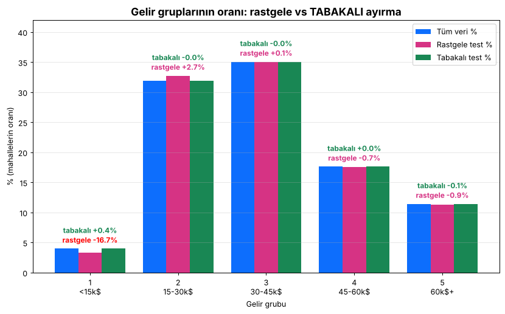

# Ders 2 — Test setini ayır (Aşama 3)

Kod: [`src/01_test_setini_ayir.py`](../src/01_test_setini_ayir.py)
Çıktı: `data/hazir/egitim.csv` (16.512 satır), `data/hazir/test.csv` (4.128 satır)

## Neden ayırıyoruz?

Sınav sorularını önceden gören öğrencinin notu, ne kadar bildiğini göstermez.
Test seti modelin **hiç görmediği** veri olmalı. Üstelik biz de ona bakmamalıyız
(**data snooping**: test verisine göre karar verirsek, test bizim için de artık "görülmüş" olur).

## Kod adım adım

| Adım | Kod | Ne yapıyor |
|---|---|---|
| 1 | `pd.read_csv(...)` | CSV'yi tabloya (DataFrame) çevirir |
| 2 | `pd.cut(df["median_income"], bins=..., labels=...)` | Geliri 5 gruba böler |
| 3 | `train_test_split(df, test_size=0.2, random_state=7, stratify=df["gelir_grubu"])` | %80/%20 ayırır, her gelir grubundan aynı oranda alır |
| 4 | `drop(columns="gelir_grubu")` + `to_csv` | Yardımcı sütunu siler, dosyaya kaydeder |

## Rastgele vs tabakalı (stratified) örnekleme



| Gelir grubu | Tüm veri | Rastgele test | Tabakalı test |
|---|---|---|---|
| 1 (<15k$) | %3,98 | %3,32 (**−16,7 hata**) | %4,00 (+0,4) |
| 2 | %31,88 | %32,75 | %31,88 |
| 3 | %35,06 | %35,08 | %35,05 |
| 4 | %17,63 | %17,51 | %17,64 |
| 5 (60k$+) | %11,44 | %11,34 | %11,43 |

## `random_state` nedir?

Bilgisayardaki "rastgelelik" aslında bir formüldür ve bir **tohum (seed)** sayısıyla başlar.
- Aynı tohum → her çalıştırmada **aynı** karıştırma → sonuçlar tekrarlanabilir
- Farklı tohum → farklı mahalleler test setine düşer
- Tohumun büyüklüğü rastgeleliği artırmaz ve modeli iyileştirmez. 42 sadece bir gelenek (Otostopçunun Galaksi Rehberi).

```
seed 7  -> ilk 5 test satırı: [4648, 8740, 162, 15735, 18380]
seed 42 -> ilk 5 test satırı: [20046, 3024, 15663, 20484, 9814]
```

## Quiz 2 — notlar

| Soru | Doğru cevap |
|---|---|
| S5: Adil test seti nasıl? | Geliri gruplara böl, her gruptan **tüm verideki oranıyla** örnek al → `stratify=` |
| S6: `random_state` 7 → 42 | **b)** Test setine farklı mahalleler düşer. Model daha iyi öğrenmez. |
| S7: `test_size=0.25` | 20640 × 0,75 = **15.480** eğitim, 5.160 test |

Not: **r = 0,69 bir korelasyon katsayısıdır, "doğruluk" değildir.** −1 ile +1 arasında, iki sütunun birlikte ne kadar
doğrusal hareket ettiğini ölçer.
