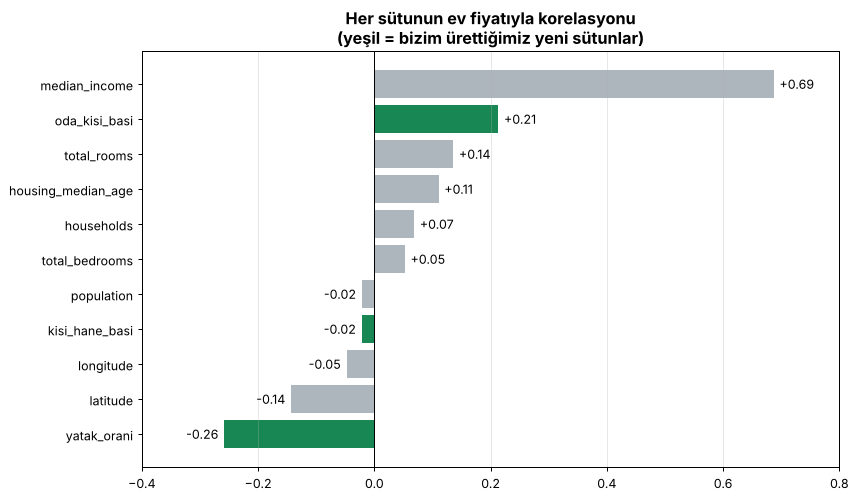
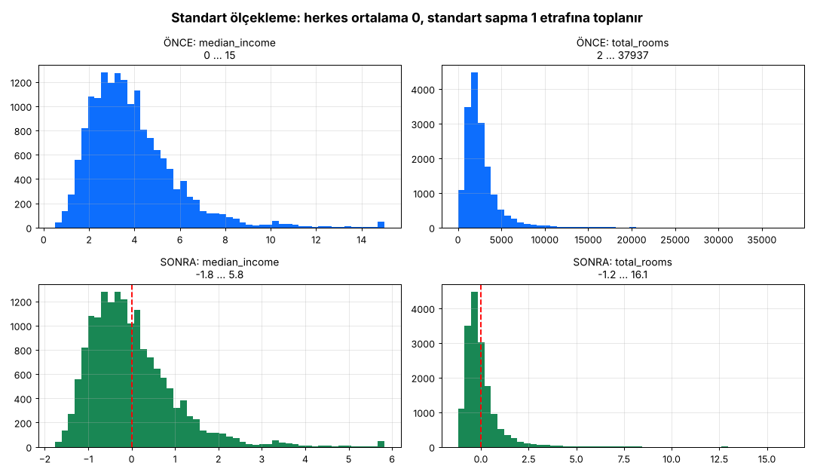
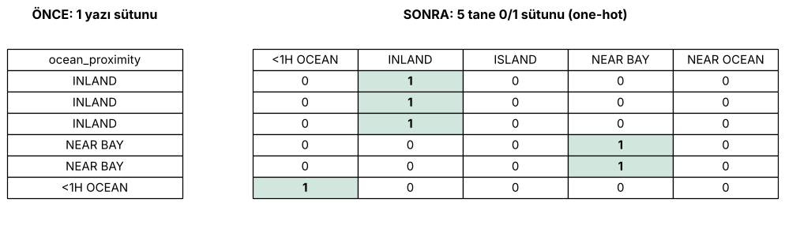

# Ders 3 — Veriyi hazırla (Aşama 4)

Kod: [`src/hazirlik.py`](../src/hazirlik.py) (araçlar) + [`src/02_veriyi_hazirla.py`](../src/02_veriyi_hazirla.py) (adım adım çalıştırma)
Çıktı: `modeller/hazirlayici.joblib`

## Akış

```
egitim.csv (16.512 × 10)
   │ 4.1  y'yi ayır            → X (16.512 × 9), y (16.512)
   │ 4.2  yeni sütunlar        → X (16.512 × 12)
   │ 4.3  ogren(X)             → medyanlar, ortalama/std'ler, kategoriler (SADECE eğitimden)
   │ 4.4  donustur(X)          → doldur → ölçekle → one-hot → yapıştır
   ▼
X_hazir (16.512 × 16), hiç boş hücre yok, hepsi sayı
```

## 4.2 Yeni sütunlar (feature engineering)



| Yeni sütun | Formül | Korelasyon | Yorum |
|---|---|---|---|
| `oda_kisi_basi` | total_rooms / population | **+0,21** | Kişi başına oda arttıkça fiyat artıyor (öğrencinin fikri, S9). Orijinal `total_rooms` (+0,14) sütunundan daha bilgili. |
| `yatak_orani` | total_bedrooms / total_rooms | **−0,26** | Odaların çoğu yatak odasıysa evler küçük ve ucuz |
| `kisi_hane_basi` | population / households | −0,02 | Tek başına zayıf, ama başka sütunlarla birlikte işe yarayabilir |

## 4.3 Boşluk doldurma: `SimpleImputer(strategy="median")`

- `fit` eğitimdeki medyanı öğrenir → `total_bedrooms` için **435**
- `transform` her boş hücreye 435 yazar (eğitimde 162, testte 45 boş hücre var)

## 4.4a Ölçekleme: `StandardScaler`



`yeni = (değer − ortalama) / standart_sapma`, yani her sütun "ortalamadan kaç std uzakta?" sorusuna çevrilir.
Normalizasyondan (0–1 arası) farkı: uç değerler (örneğin 37.937 oda) diğer herkesi 0'ın dibine sıkıştırmaz.

## 4.4b One-hot encoding: `OneHotEncoder`



**Neden `0,1,2,3,4` değil?** Model sayılara bakınca şöyle düşünür:
- `NEAR OCEAN (4) > INLAND (1)` → yanlış bir **sıralama** ima eder
- `NEAR BAY (3) − INLAND (1) = ISLAND (2)` → anlamsız bir **aritmetik**

One-hot ile her kategori kendi 0/1 sütununu alır. Hiçbiri diğerinden "büyük" değildir.

## Altın kural: `fit` eğitimde, `transform` her yerde

| | Eğitim | Test | Yeni veri |
|---|---|---|---|
| `ogren()` (fit) | ✅ | ❌ | ❌ |
| `donustur()` (transform) | ✅ | ✅ | ✅ |

Test setinin medyanını kullanmak, sınavdan önce soruların ortalamasına bakmak gibidir (veri sızıntısı, *data leakage*).
Gerçek hayatta yarın gelecek verinin medyanını bugünden bilemeyiz.

## Quiz 3 — notlar

| Soru | Doğru cevap |
|---|---|
| S8: 0–4 numaralandırma | Sahte sıralama ve sahte uzaklık oluşturur → **one-hot** |
| S9: Oda sayısını anlamlı yap | Oran üret: `total_rooms / population` (+0,21) veya `/ households` (+0,15) |
| S10: Medyan hangi veriden? | **b) Sadece eğitim.** Test geleceği temsil eder; geleceğin istatistiği bilinemez. |
