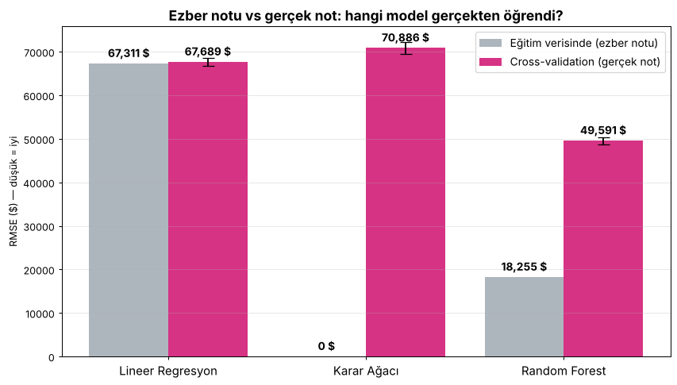
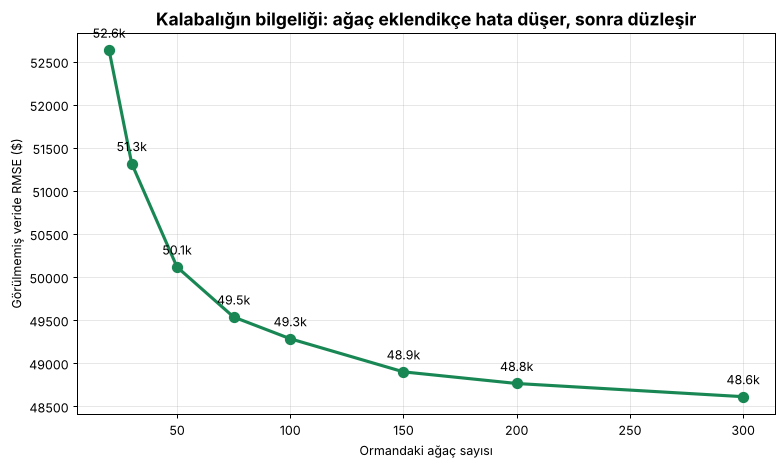

# Ders 4 — Model eğit (Aşama 5)

Kod: [`src/03_model_egit.py`](../src/03_model_egit.py) · Log: [`loglar/egitim.log`](../loglar/egitim.log) · Sonuçlar: `modeller/sonuclar.json`
Süre: bu makinede (4 CPU) ~35 saniye.

## RMSE nedir?

```
RMSE = karekök( ortalama( (gerçek − tahmin)² ) )
```

| Mahalle | Gerçek | Tahmin | Hata |
|---|---|---|---|
| A | 200.000 | 250.000 | +50.000 |
| B | 300.000 | 260.000 | −40.000 |
| C | 150.000 | 140.000 | −10.000 |

Kare al → ortalamasını al → karekökünü al = **~37.000 $**.
**Tercüme:** "Tahminlerimiz tipik olarak ±37.000 $ sapıyor." Birimi **dolar**, yüzde değil.
Kare almanın etkisi: büyük hatalar daha ağır cezalandırılır.

## 3 model, tek kalıp

scikit-learn'deki bütün modeller aynı iki komutla çalışır:

```python
model = RandomForestRegressor()   # 1) boş beyin
model.fit(X, y)                   # 2) öğren
tahmin = model.predict(X_yeni)    # 3) tahmin et
```

## Sonuçlar



| Model | Eğitimde RMSE (ezber notu) | 5-katlı CV RMSE (gerçek not) | Teşhis |
|---|---|---|---|
| Lineer Regresyon | 67.311 $ | 67.689 ± 901 $ | **Underfitting**: çok basit, iki notu da kötü |
| Karar Ağacı | **0 $** 🤯 | 70.886 ± 1.330 $ | **Overfitting**: ezberlemiş, yeni veride en kötü |
| Random Forest | 18.255 $ | **49.591 ± 803 $** 🏆 | En iyisi, ama arada hâlâ büyük bir fark var (biraz ezber) |

## Cross-validation (çapraz doğrulama)

Test setine dokunmadan "gerçek not" almanın yolu:

```
Eğitim verisi 5 parçaya bölünür:  [1][2][3][4][5]
Tur 1:  eğit [2][3][4][5] → ölç [1]
Tur 2:  eğit [1][3][4][5] → ölç [2]
...
Tur 5:  eğit [1][2][3][4] → ölç [5]
Sonuç = 5 notun ortalaması ± dağılımı
```

Her turda hazırlayıcı (`ogren`) de **sadece o turun eğitim parçasından** öğrenir, yani altın kural burada da geçerli.

## Orman büyürken



`warm_start=True` ile ormana ağaç ekleyerek hatayı izledik. **Torba dışı (OOB)** ölçüm şöyle çalışır: her ağaç verinin rastgele bir torbasıyla eğitilir ve
satırların ~%37'sini hiç görmez. O satırlar o ağaç için mini bir test setidir.

- 20 ağaç: 52.634 $ → 100 ağaç: 49.285 $ → 300 ağaç: 48.612 $
- İlk 100 ağaç çok şey kazandırıyor, sonrasında getiri azalıyor (**azalan verim**).

## Model neye bakıyor? (özellik önemi)

| Sıra | Özellik | Önem |
|---|---|---|
| 1 | `median_income` | 0,46 |
| 2 | `ocean_proximity_INLAND` | 0,14 |
| 3 | `kisi_hane_basi` | 0,09 ← tek başına korelasyonu −0,02 idi! |
| 4 | `longitude` | 0,07 |
| 5 | `oda_kisi_basi` | 0,06 ← öğrencinin fikri |

Ders: **Korelasyon sadece düz çizgi ilişkisini ölçer.** Ağaçlar eğri ilişkileri ve
sütunlar arası etkileşimleri de yakalayabilir. `kisi_hane_basi` tek başına işe yaramaz görünüyordu, ama ormanın 3. favorisi oldu.

## Quiz 4 — notlar

| Soru | Doğru cevap |
|---|---|
| S11: RMSE = 50.000 | "Tahminlerimiz tipik olarak ±50.000 $ sapıyor." Yüzde değil, dolar. Ortalama fiyat ~207k olduğu için kabaca %24'lük bir hata. |
| S12: Eğitimdeki sıralama | Ağaç (0) < Forest (18k) < Lineer (67k). Gerçek notta: Forest (50k) < Lineer (68k) < Ağaç (71k). |
| S13: RMSE = 0 | Sevinmemeli. Bu **overfitting** (aşırı öğrenme / ezber): model gürültüyü de ezberler ve yeni veride çöker. |
