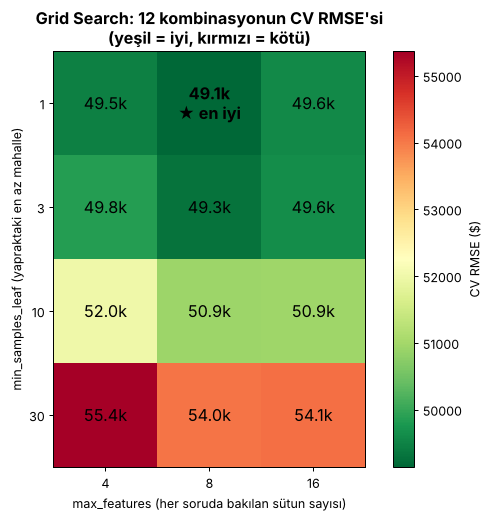
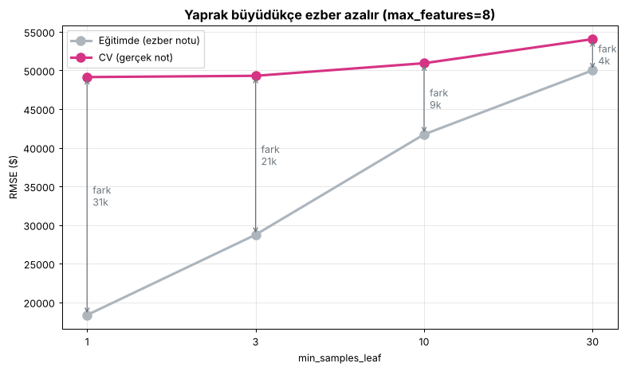

# Ders 5 — İnce ayar (Aşama 6)

Kod: [`src/04_ince_ayar.py`](../src/04_ince_ayar.py) · Log: [`loglar/ince_ayar.log`](../loglar/ince_ayar.log) · Sonuçlar: [`modeller/ince_ayar_sonuclari.json`](../modeller/ince_ayar_sonuclari.json)
Süre: bu makinede (4 CPU, paralel) ~98 saniye.

## Parametre vs hiperparametre

| | Kim belirler? | Örnek | Nasıl bulunur? |
|---|---|---|---|
| **Parametre** | Model, `fit()` sırasında **kendisi öğrenir** | Ağaçtaki "gelir > 5,2 mi?" sorusundaki 5,2; lineer regresyondaki katsayılar | Eğitim |
| **Hiperparametre** | **Biz** eğitimden önce ayarlarız (düğmeler) | `n_estimators`, `max_features`, `min_samples_leaf` | Deneme + **cross-validation** |

Neden önemli? Hiperparametreler `fit()` ile öğrenilemez, mutlaka **dışarıdan denenip ölçülmeleri** gerekir.
Bu ölçüm **test setiyle yapılmamalı**, yoksa test seti de "görülmüş" olur.

## Pipeline: hazırlık + model tek makinede

```python
makine = Pipeline([
    ("hazirla", Hazirlayici()),          # yeni sütunlar + doldur + ölçekle + one-hot
    ("model",   RandomForestRegressor()),
])
makine.fit(X_ham, y)                     # hazırlayıcı öğrenir → model öğrenir
makine.predict(X_ham_yeni)               # hazırlayıcı dönüştürür → model tahmin eder
```

Faydaları: ① Ham veri verip tahmin almak tek satır. ② CV'nin her turunda hazırlayıcı yeniden `fit` edildiği için **sızıntı yok**.
③ Kaydettiğimiz tek dosya her şeyi içerir.

## Grid Search

```python
izgara = {"model__max_features": [4, 8, 16], "model__min_samples_leaf": [1, 3, 10, 30]}
arama = GridSearchCV(makine, izgara, cv=5, scoring="neg_root_mean_squared_error")
arama.fit(X, y)
```

**Hesap:** 3 × 4 = 12 kombinasyon × 5 kat = **60 eğitim** (+1: kazananı tüm veriyle yeniden eğitme).
Sırayla çalışsa ~6 sn × 61 ≈ 6 dk sürerdi. 4 CPU paralel çalıştığı için **1,6 dk** sürdü.



| max_features | min_samples_leaf | Eğitim RMSE | CV RMSE |
|---|---|---|---|
| **8** | **1** | 18.352 | **49.140** ★ |
| 8 | 3 | 28.738 | 49.303 |
| 4 | 1 | 18.581 | 49.471 |
| 16 | 1 | 18.519 | 49.591 (Aşama 5'teki varsayılan) |
| … | 30 | ~50.000 | ~54.000–55.000 (underfitting) |

## `min_samples_leaf`: ezber düğmesi



- Yaprak büyüdükçe **eğitim ile CV arasındaki fark kapanıyor** (ezber azalıyor) ✅ S15'teki tahmin doğru.
- Ama fark kapandı diye CV notu iyileşmiyor: 30'da model **fazla basitleşiyor** (underfitting).
- En iyi nokta ikisinin arasında: **bias–variance dengesi** (çok basit ↔ çok ezberci).

## Dürüst sonuç

İnce ayar sadece **~450 $** kazandırdı (49.591 → 49.140). Random Forest varsayılan ayarlarıyla zaten iyi.
Büyük kazançlar genelde **daha iyi veri ve özelliklerden** gelir, düğme çevirmekten değil.

## Quiz 5 — notlar

| Soru | Doğru cevap |
|---|---|
| S14: Öğrenilen vs ayarlanan | **Parametre** (model öğrenir) vs **hiperparametre** (biz ayarlarız). Hiperparametreler CV ile seçilir, test setiyle asla. |
| S15: `min_samples_leaf` 1 → 10 | Ezber **azalır**: her yaprak en az 10 mahallenin ortalamasını vermek zorunda, tek bir mahallenin gürültüsünü ezberleyemez. |
| S16: Kaç eğitim? | 3 × 4 × 5 = **60** (+1). Süre ≈ 60 × 3 sn = 3 dk (sıralı). Gerçekte paralel çalıştığı için 1,6 dk. |

Not: `modeller/en_iyi_model.joblib` ~31 MB olduğu için git'e eklenmedi. `python src/04_ince_ayar.py` ile yeniden üretilir.
