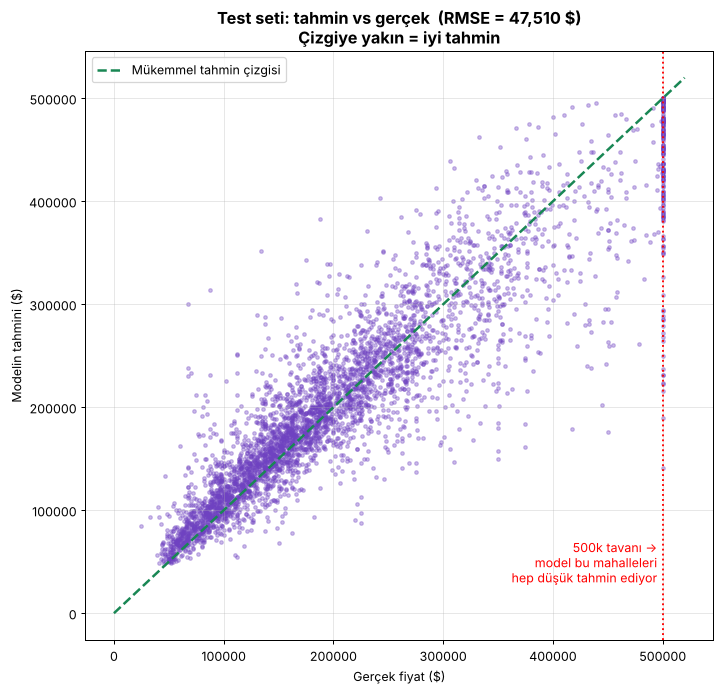
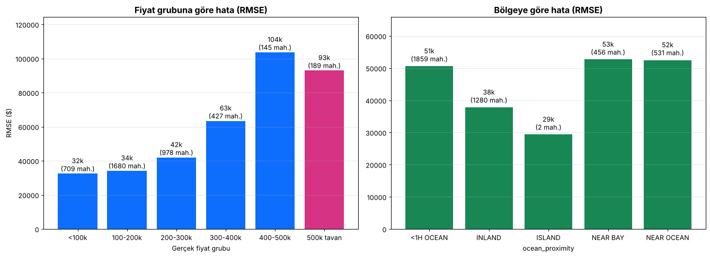

# Ders 6 — Büyük sınav (Aşama 7)

Kod: [`src/05_test_et.py`](../src/05_test_et.py) · Çıktı: [`loglar/test.log`](../loglar/test.log), [`modeller/test_sonuclari.json`](../modeller/test_sonuclari.json)

## Karne

| Ölçüm | Değer |
|---|---|
| Eğitim RMSE (ezber notu) | 17.998 $ |
| CV RMSE (deneme sınavı) | 49.140 $ |
| **TEST RMSE (final)** | **47.510 $** |
| %95 güven aralığı | 45.383 $ … 49.545 $ |
| Test MAE (tipik hata) | 31.322 $ |
| Tavan mahalleleri hariç RMSE | 44.173 $ |

**Yorum:** Test notu CV notuyla **neredeyse aynı** (hatta biraz daha iyi, ama güven aralığının içinde). Bu, CV'nin dürüst bir
"deneme sınavı" olduğunu gösteriyor. Model ezberlememiş, gerçekten genelleyebiliyor.

### RMSE vs MAE

- **MAE** = hataların mutlak değerlerinin ortalaması → "tipik bir mahallede ~31k $ yanılıyoruz"
- **RMSE** = büyük hataları karesiyle cezalandırır → hep MAE'den büyüktür. Aradaki fark büyükse, arada sırada **çok büyük hatalar** var demektir.

### Güven aralığı

Tek bir test seti şansa bağlıdır. "Başka 4.128 mahalle seçseydik RMSE %95 ihtimalle 45k–50k arasında çıkardı" demek.

## Hata analizi

| Bulgu | Açıklama |
|---|---|
| **Pahalı mahallelerde hata 3 kat** | <200k: ~33k $ hata · 400–500k: 104k $ hata |
| **Ortalamaya çekilme** | Ucuzları ortalama +18k pahalı, pahalıları −73k ucuz tahmin ediyor. Random Forest ağaç ortalamaları aldığı için uç değerlere ulaşamıyor. |
| **500k tavanı** | 189 mahallenin gerçek fiyatı muhtemelen 500k'dan fazla ama veride 500.001 yazıyor. Model 500k üstünü hiç görmediği için bu mahalleler yapısal olarak düşük tahmin ediliyor. |
| **En kötü 5 tahmin** | Hepsi tavan mahalleleri, ve çoğunda gelir düşük (0,5–2). Muhtemelen veri hatası veya özel durumlar (öğrenci yurtları vb.). |
| **INLAND en kolay bölge** | 38k $ hata. Kıyı bölgelerinde 51–53k. Kıyıda fiyatlar daha değişken. |

## Ne yapılabilirdi? (gelecek iş)

1. Tavan mahallelerini eğitimden çıkarmak, ya da 500k üstü için ayrı bir "pahalı mı?" sınıflandırıcısı kurmak
2. Konum için daha akıllı özellikler: büyük şehirlere uzaklık, kümeleme (k-means) ile bölge benzerliği
3. Daha güçlü modeller: Gradient Boosting (HistGradientBoostingRegressor, XGBoost)

## Altın kural: test seti tek kullanımlıktır

Bu sonuca bakıp geri dönüp ayar yaparsak test seti artık "görülmüş" olur ve notumuz şişer.
Bundan sonraki iyileştirmeler için **yeni** bir test setine ihtiyaç var.

## Quiz 6 — notlar

| Soru | Doğru cevap |
|---|---|
| S17: Test notu? | **b) yaklaşık aynı.** CV zaten görülmemiş veride ölçüyordu. Sonuç 47,5k çıktı (CV 49,1k). |
| S18: Test kötüyse ayar yapılır mı? | Hayır. Test setine **uydurmak** (overfitting to the test set) olur. Test tek kullanımlık. |
| S19: En büyük hatalar? | **500k tavanındaki ve pahalı mahallelerde.** Bulgu doğrulandı. |
