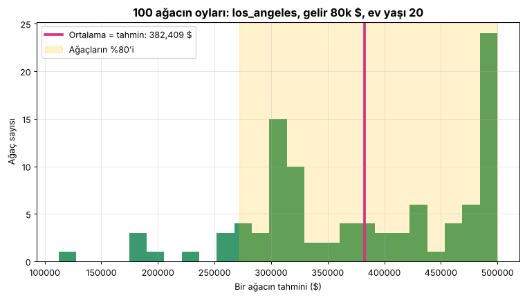

# Ders 7 — Kaydet ve kullan (Aşama 8)

Kod: [`src/06_tahmin_et.py`](../src/06_tahmin_et.py)

## Kullanım

```bash
python src/06_tahmin_et.py --sehir los_angeles --gelir 80000 --yas 20 --grafik
```
```
📍 los_angeles  |  gelir 80,000 $  |  ev yaşı 20  |  <1H OCEAN
🏠 TAHMİN: 382,409 $   (1990 doları)
🌲 Ağaçların %80'i şu aralıkta: 271,990 $ … 500,001 $
```

Şehirler: `san_francisco`, `los_angeles`, `san_diego`, `sacramento`, `fresno`.
Verilmeyen bilgiler (oda, nüfus, hane) eğitimdeki tipik mahallenin medyan değerleriyle doldurulur.

## 100 ağacın oyları



Random Forest'ın tahmini, 100 ağacın tahminlerinin **ortalamasıdır**. Oylar ne kadar dağınıksa model o kadar emin değildir.
Bu mahallede oylar 110k ile 500k arasında, yani model **kararsız**. Sebebi şu: yıllık 80k $ gelir 1990'da çok yüksekti
(mahallelerin sadece **%3,3**'ü bu seviyede), dolayısıyla model bu bölgede az örnek görmüş.

## Ağaçlar dışarıyı tahmin edemez (extrapolation)

| Gelir (LA, ev yaşı 20) | Tahmin |
|---|---|
| 30k $ | 221k $ |
| 50k $ | 249k $ |
| 80k $ | 382k $ |
| 120k $ | 418k $ |
| 150k $ | **418k $** (aynı!) |

Bir ağaç sadece eğitimde gördüğü değer aralığında "soru" sorabilir. 120k üstünde artık yeni bir soru yok,
o yüzden tahmin düzleşir. Lineer regresyon ise çizgiyi sonsuza kadar uzatır (o da ayrı bir tehlike).

## Bir modeli "teslim etmek" için ne gerekir?

| Parça | Neden | Bizde |
|---|---|---|
| Eğitilmiş model | Öğrenilen ağaçlar | `modeller/en_iyi_model.joblib` içinde |
| **Hazırlayıcı** (ölçü defteri) | Medyanlar, ortalama/std'ler, kategoriler. Bunlar olmadan yeni veri modelin beklediği şekle girmez. | Aynı dosyada (Pipeline sayesinde) |
| **Kod** | joblib, `Hazirlayici` sınıfının kodunu değil, sadece adını kaydeder. Açan kişide `src/hazirlik.py` de olmalı. | `src/hazirlik.py` |
| Kütüphane sürümleri | Farklı scikit-learn sürümü dosyayı açamayabilir | scikit-learn 1.9.1 |
| ~~Eğitim verisi~~ | **Gerekmez.** Model veriden öğrendiğini zaten içinde taşıyor. (Bizim araç sadece "tipik mahalle" varsayılanları için okuyor.) | — |

## Canlıya almak, izlemek, bakım (checklist'in 8. adımı)

- **Veri kayması (data drift):** Dünya değişir. 1990 modeli 2026'da sistematik olarak çok düşük tahmin eder. Model bunu **kendisi fark edemez**,
  çünkü hiçbir zaman "yanıldım" bilgisi almaz.
- **İzleme:** Gerçek satış fiyatları geldikçe tahminlerle karşılaştır. Hata grafiği yükselmeye başlarsa alarm ver.
- **Bakım:** Yeni veriyle düzenli olarak yeniden eğit (bu repodaki scriptler baştan sona tekrar çalıştırılabilir).

## Quiz 7 — notlar

| Soru | Doğru cevap |
|---|---|
| S20: 1990 modeli 2026'da | Fiyatları çok düşük tahmin eder (**veri kayması**). Model fark edemez. İzleme + güncel veriyle yeniden eğitim gerekir. |
| S21: Ne gönderilmeli? | Model + **hazırlayıcı** (Pipeline içinde) + `hazirlik.py` kodu + sürüm bilgisi. Eğitim verisi gerekmez. |
| S22: LA, 80k gelir, 20 yaş | Öğrenci tahmini 200k (LA'daki tipik mahallenin medyanı: 204k). Model: **382k**. 80k gelir 1990'da mahallelerin ilk %3,3'üne giriyordu. |
